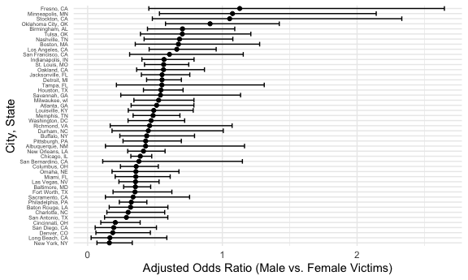
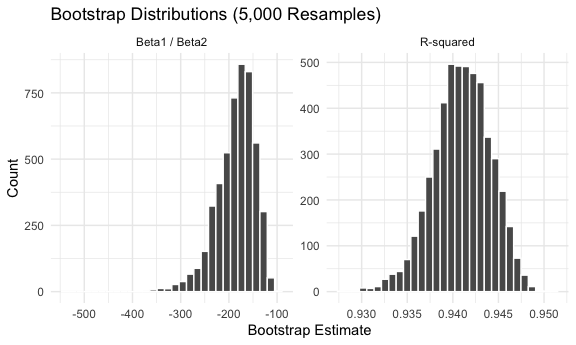
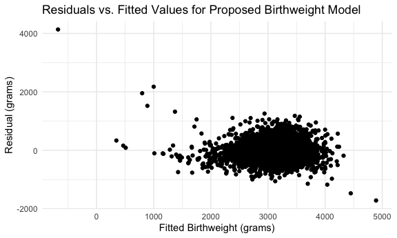

Homework 6
================
Alexa Burko
2026-11-23

# Problem 1

``` r
homicide_df =
  read_csv("data/homicide-data.csv") |>
  janitor::clean_names() |>
    mutate(
    city_state = paste(city, state, sep = ", "),
    solved = str_detect(disposition, "Closed"),
    victim_age = as.numeric(victim_age)) |> 
  filter(victim_race %in% c("Black", "White"),
         !(city_state %in% c("Dallas, TX", "Phoenix, AZ", "Kansas City, MO", "Tulsa, AL"))) 
```

    ## Rows: 52179 Columns: 12
    ## ── Column specification ────────────────────────────────────────────────────────
    ## Delimiter: ","
    ## chr (9): uid, victim_last, victim_first, victim_race, victim_age, victim_sex...
    ## dbl (3): reported_date, lat, lon
    ## 
    ## ℹ Use `spec()` to retrieve the full column specification for this data.
    ## ℹ Specify the column types or set `show_col_types = FALSE` to quiet this message.

    ## Warning: There was 1 warning in `mutate()`.
    ## ℹ In argument: `victim_age = as.numeric(victim_age)`.
    ## Caused by warning:
    ## ! NAs introduced by coercion

``` r
homicide_df_clean <- homicide_df %>%
  mutate(across(where(is.character), ~ iconv(.x, from = "", to = "UTF-8", sub = "")))
# had to do this so that I could view the dataset
```

``` r
fit_logistic_balt =
  homicide_df_clean |> 
  filter(city_state == "Baltimore, MD") |> 
  glm(solved ~ victim_age + victim_race + victim_sex, data = _, family = binomial())


fit_logistic_balt |>
  broom::tidy(conf.int = TRUE) |>
  mutate(
    OR = exp(estimate),
    lower_conf = exp(conf.low),
    upper_conf = exp(conf.high)
  ) |>
  filter(term == "victim_sexMale") |>
  select(term, estimate, OR, lower_conf, upper_conf, p.value) |>
  knitr::kable(digits = 3)
```

| term           | estimate |    OR | lower_conf | upper_conf | p.value |
|:---------------|---------:|------:|-----------:|-----------:|--------:|
| victim_sexMale |   -1.037 | 0.355 |      0.267 |      0.468 |       0 |

The odds of a homicide being solved when the victim is male is 0.36
times the odds of a homicide being solved when the victim is female (95%
CI: 0.27, 0.47).

``` r
city_ors <- homicide_df_clean |>
  mutate(victim_sex = fct_relevel(victim_sex, "Female")) |>
  nest(data = -city_state) |>
  mutate(
    model_fits = map(data, \(df) glm(solved ~ victim_age + victim_race + victim_sex, data = df, family = binomial()))
  ) |>
  mutate(
    results = map(model_fits, \(mod) tidy(mod, conf.int = TRUE, exponentiate = TRUE))
  ) |>
  select(city_state, results) |>
  unnest(results) |>
  filter(term == "victim_sexMale") |>
  select(city_state, term, OR = estimate, conf.low, conf.high)
```

    ## Warning: There were 43 warnings in `mutate()`.
    ## The first warning was:
    ## ℹ In argument: `results = map(model_fits, function(mod) tidy(mod, conf.int =
    ##   TRUE, exponentiate = TRUE))`.
    ## Caused by warning:
    ## ! glm.fit: fitted probabilities numerically 0 or 1 occurred
    ## ℹ Run `dplyr::last_dplyr_warnings()` to see the 42 remaining warnings.

``` r
city_ors |>
  mutate(city_state = fct_reorder(city_state, OR)) |>
  ggplot(aes(x = OR, y = city_state)) +
  geom_errorbar(aes(xmin = conf.low, xmax = conf.high), orientation = "y") +
  geom_point() +
  labs(
    x = "Adjusted Odds Ratio (Male vs. Female Victims)",
    y = "City, State"
  ) +
  theme(axis.text.y = element_text(size = 5))
```



The city with the highest odds of a homicide being solved when the
victim is male compared to when the victim is female is Fresno, CA, with
an odds ratio greater than 1. The city with the lowest odds of a
homicide being solved when the victim is male compared to when the
victim is female is New York, NY, with an odds ratio greater than 1.

# Problem 2

``` r
library(p8105.datasets)
data("weather_df")
```

``` r
weather_bootstrap_df =
  weather_df |> 
  modelr::bootstrap(n = 5000) |> 
  mutate(
    model_fits = map(strap, \(df) lm(tmax ~ tmin + prcp, data = df)),
    results = map(model_fits, broom::tidy)
  )
```

``` r
weather_bootstrap_estimates <- weather_bootstrap_df |>
  mutate(
    glance_info = map(model_fits, broom::glance),
    r_squared = map_dbl(glance_info, "r.squared"),
    beta_ratio = map_dbl(results, \(tib) {
      b1 <- tib |> filter(term == "tmin") |> pull(estimate)
      b2 <- tib |> filter(term == "prcp") |> pull(estimate)
      b1 / b2
    })
  )

weather_bootstrap_quantiles <- weather_bootstrap_estimates |>
  summarise(
    r2_q025 = quantile(r_squared, probs = 0.025, na.rm = TRUE),
    r2_q975 = quantile(r_squared, probs = 0.975, na.rm = TRUE),
    ratio_q025 = quantile(beta_ratio, probs = 0.025, na.rm = TRUE),
    ratio_q975 = quantile(beta_ratio, probs = 0.975, na.rm = TRUE)
  )
```

``` r
weather_bootstrap_estimates |>
  select(.id, r_squared, beta_ratio) |>
  pivot_longer(
    cols = c(r_squared, beta_ratio),
    names_to = "parameter",
    values_to = "estimate"
  ) |>
  mutate(
    parameter = recode(
      parameter,
      r_squared = "R-squared",
      beta_ratio = "Beta1 / Beta2"
    )
  ) |>
  ggplot(aes(x = estimate)) +
  geom_histogram(color = "white") +
  facet_wrap(~ parameter, scales = "free") +
  labs(
    title = "Bootstrap Distributions (5,000 Resamples)",
    x = "Bootstrap Estimate",
    y = "Count"
  ) +
  theme_minimal()
```

    ## `stat_bin()` using `bins = 30`. Pick better value `binwidth`.



The plot of the beta ratios is slightly left skewed, though the central
tendency is about -175. The plot of the R-squared values are roughly
normally distributed with a mean of about 0.941

# Problem 3

``` r
child_df =
  read_csv("data/birthweight.csv", na = c("", "NA", ".")) |>
  janitor::clean_names() |>
  mutate(
    babysex = factor(case_match(
      babysex,
      1 ~ "Male",
      2 ~ "Female"
    )),
    malform = factor(case_match(
      malform,
      0 ~ "Absent",
      1 ~ "Present"
    )),
    frace = factor(case_match(
      frace,
      1 ~ "White",
      2 ~ "Black",
      3 ~ "Asian",
      4 ~ "Puerto Rican",
      8 ~ "Other"
    )),
    mrace = factor(case_match(
      mrace,
      1 ~ "White",
      2 ~ "Black",
      3 ~ "Asian",
      4 ~ "Puerto Rican",
      8 ~ "Other"
    )),
    parity = as.factor(parity),
    pnumlbw = as.factor(pnumlbw),
    pnumsga = as.factor(pnumsga)
  )
```

    ## Rows: 4342 Columns: 20
    ## ── Column specification ────────────────────────────────────────────────────────
    ## Delimiter: ","
    ## dbl (20): babysex, bhead, blength, bwt, delwt, fincome, frace, gaweeks, malf...
    ## 
    ## ℹ Use `spec()` to retrieve the full column specification for this data.
    ## ℹ Specify the column types or set `show_col_types = FALSE` to quiet this message.

    ## Warning: There was 1 warning in `mutate()`.
    ## ℹ In argument: `babysex = factor(case_match(babysex, 1 ~ "Male", 2 ~
    ##   "Female"))`.
    ## Caused by warning:
    ## ! `case_match()` was deprecated in dplyr 1.2.0.
    ## ℹ Please use `recode_values()` instead.

``` r
colSums(is.na(child_df))
```

    ##  babysex    bhead  blength      bwt    delwt  fincome    frace  gaweeks 
    ##        0        0        0        0        0        0        0        0 
    ##  malform menarche  mheight   momage    mrace   parity  pnumlbw  pnumsga 
    ##        0        0        0        0        0        0        0        0 
    ##    ppbmi     ppwt   smoken   wtgain 
    ##        0        0        0        0

``` r
# no NAs
```

``` r
proposed_mod = lm(bwt ~ babysex + blength + gaweeks + smoken, data = child_df)

child_df |> 
  add_predictions(proposed_mod) |> 
  add_residuals(proposed_mod) |> 
ggplot(aes(x = pred, y = resid))+
  geom_point() +
  labs(
    title = "Residuals vs. Fitted Values for Proposed Birthweight Model",
    x = "Fitted Birthweight (grams)",
    y = "Residual (grams)"
  ) +
  theme_minimal()
```



I picked babysex, blength, gaweeks, and smoken as the adjustment
variables in my proposed model because I know from the literature that
all of these variables are strongly associated with birthweight.

``` r
set.seed(12345)

cv_results <-
  crossv_mc(child_df, n = 100) |>
  mutate(
    proposed_fit = map(train, \(df) lm(bwt ~ babysex + blength + gaweeks + smoken, data = df)),
    main_fit = map(train, \(df) lm(bwt ~ blength + gaweeks, data = df)),
    inter_fit = map(train, \(df) lm(bwt ~ bhead * blength * babysex, data = df)),
    proposed_rmse = map2_dbl(proposed_fit, test, \(mod, df) rmse(mod, df)),
    main_rmse = map2_dbl(main_fit, test, \(mod, df) rmse(mod, df)),
    inter_rmse    = map2_dbl(inter_fit, test, \(mod, df) rmse(mod, df))
  )

cv_results |>
  pivot_longer(
    cols = c(proposed_rmse, main_rmse, inter_rmse),
    names_to = "model",
    values_to = "rmse"
  ) |>
  group_by(model) |>
  summarise(
    mean_rmse = mean(rmse, na.rm = TRUE),
    sd_rmse = sd(rmse, na.rm = TRUE)
  ) |>
  knitr::kable(digits = 3)
```

| model         | mean_rmse | sd_rmse |
|:--------------|----------:|--------:|
| inter_rmse    |   288.196 |  10.177 |
| main_rmse     |   330.883 |  14.240 |
| proposed_rmse |   330.378 |  14.020 |

This shows that the interaction model has the lowest amount of
prediction error of all the models, making the interaction model the
best fit for the data.
